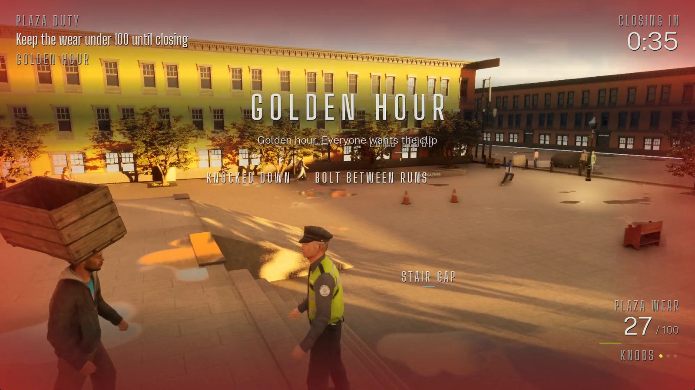
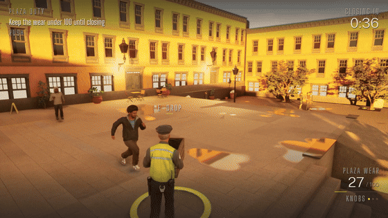
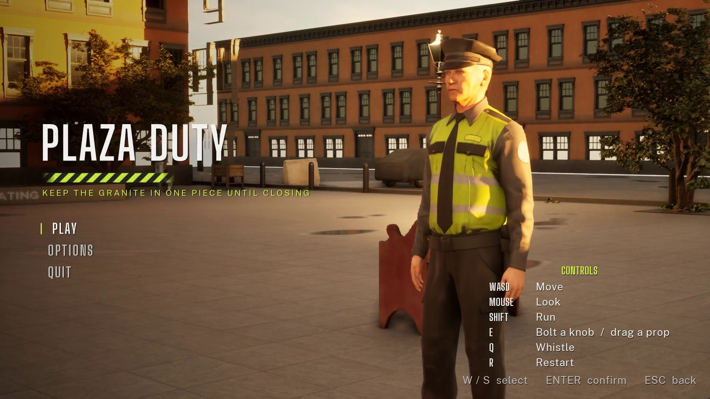
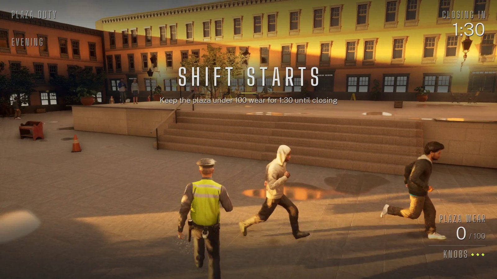
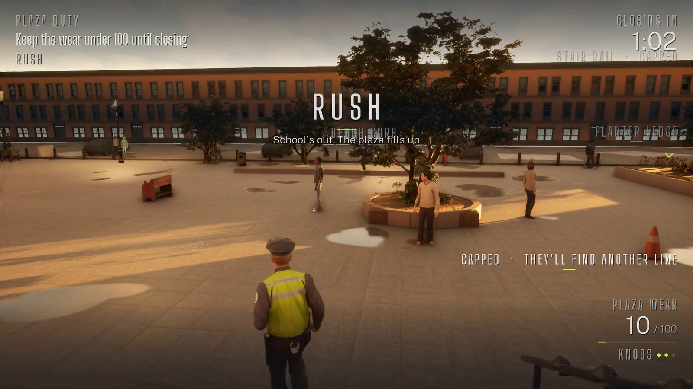
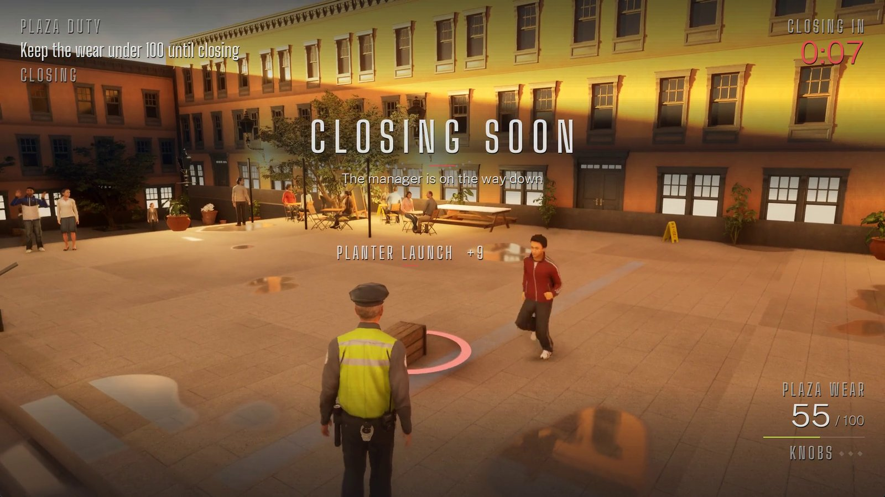

# No Skating

*Keep the granite in one piece until closing.*

A third-person arcade defence game made in **Unreal Engine 5.8** with gameplay written entirely in C++.

The project still uses its working title, **Plaza Duty** (`PlazaDuty.uproject`), which you'll see on the start screen.

## About

You are the security guard, not the skater. A crowd of skaters wants to grind every ledge, rail and stair in your city plaza, and every trick chips the Wear meter. You have three bolt-on skatestoppers that shut a line for good. Everything else you drag into the way (cones, benches, planters, bins) works for a moment, then becomes the next thing to skate.

**Goal:** Keep the plaza's Wear meter under 100 until closing time (90 seconds). If it hits 100 first, you're fired.

**[Watch the full gameplay video (MP4, with sound)](media/gameplay.mp4)**

## Controls

| Key | Action |
|---|---|
| W A S D | Move |
| Mouse | Look |
| Shift | Run |
| E (hold) | Bolt a skatestopper / drag a prop |
| Q | Whistle (scatters skaters) |
| R | Restart |

## Highlights

- Skaters pick lines by score, and props you place become new ramps and rails
- Bolting takes a 3-second hold that skaters can interrupt
- Motion-captured guard with speed-matched walk, jog and sprint
- Late-afternoon plaza that turns to blue hour as closing time nears

## Screenshots

| | |
|---|---|
|  Start screen |  Shift starts: the first skaters roll in |
|  Rush |  Closing soon |

## Play it

1. Install **Unreal Engine 5.8** (Epic Games Launcher) and **Visual Studio 2022** with the *Game development with C++* workload.
2. Download `NoSkating-UE5.8-project.zip` from the [Releases](../../releases) page and unzip it.
3. Double-click `PlazaDuty.uproject` and say **Yes** when it asks to build the modules.
4. Press **Play** in the editor, or right-click the `.uproject` and choose *Launch game*.

This repository holds the source and config. The levels, art and audio (`Content/`) are only in the release zip, because they are too large for git.

## Project layout

| Folder | What's in it |
|---|---|
| `Source/PlazaDuty/` | all gameplay code (C++) |
| `Config/` | engine, input and game settings, including tuning values |
| `media/` | screenshots for this page |

## Credits and licence

Third-party assets (all free to use and redistribute) are listed with their authors and licences in [CREDITS.md](CREDITS.md). The licence and notice files that came with them are in [licenses/](licenses/) and in the release zip.
The code and original content are **all rights reserved**: see [LICENSE](LICENSE).
